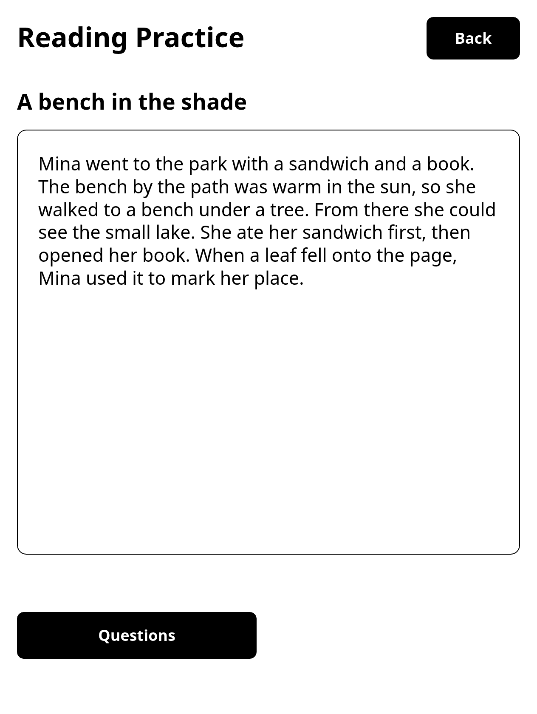
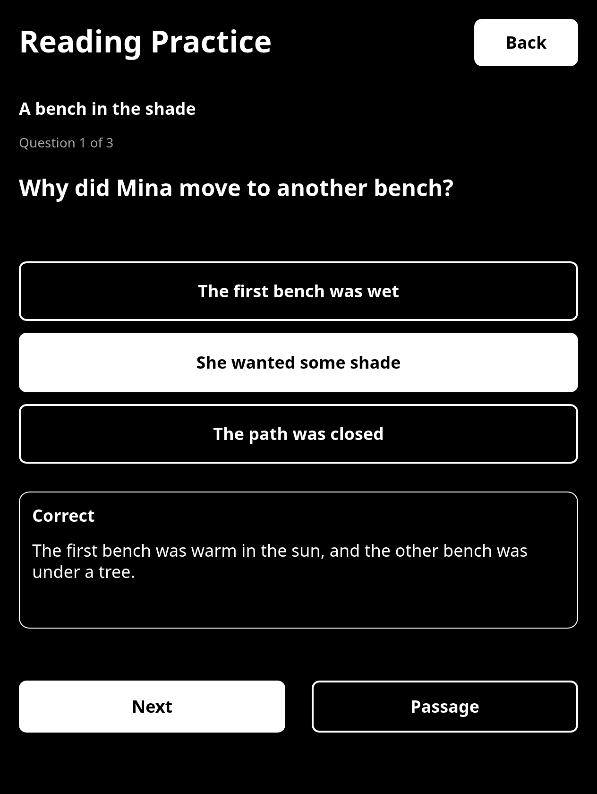

# Reading Practice

Reading Practice brings twelve original short passages and thirty-six comprehension questions to Kindle. Each passage has three questions with a brief explanation after each answer.

- Choose **Level 1** or **Level 2**, then tap a passage or **Continue**.
- Read the page and tap **Questions**. Open **Passage** from a question to look back at the text.
- Tap an answer, read the explanation, and choose **Next**. At the end, use **Retry missed** or read the whole passage again.

The app saves each passage separately, including the current question and selected answer. Going back to the passage preserves both. All text and practice work offline.

<table>
  <tr>
    <td></td>
    <td></td>
  </tr>
</table>

The screenshots come from the desktop simulation.

## Install

Find **Reading Practice** in PrimitiveOS Store. [Local build and packaging instructions](INSTALL.md)

## Test locally

```sh
cargo test --offline --locked --workspace
cargo run --offline --locked -p reading-practice-desktop -- build/previews
```

See `docs/images/` for captured screens. The simulation uses the Launcher fonts from a sibling checkout.

## Licence

Copyright (C) 2026 Doan Nguyen.

The code uses the [PolyForm Noncommercial License 1.0.0](LICENSE).
Project-owned documentation, artwork, screenshots, and original exercise content use [CC BY-NC-SA 4.0](LICENSE-DOCS).
